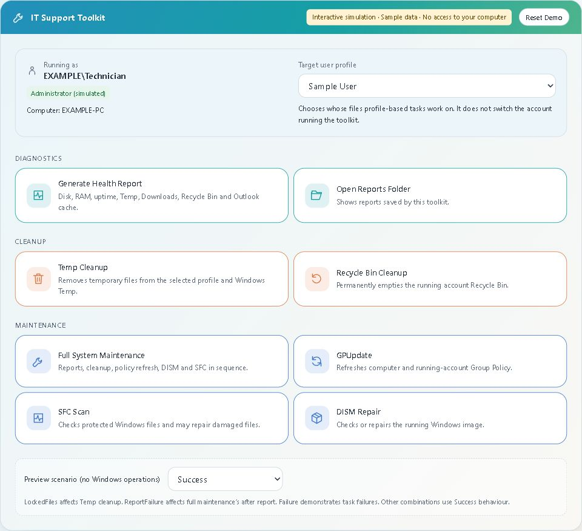

# Windows IT Support Toolkit

*Everyday Windows health checks, cleanup and maintenance in one desktop window.*

**[Try the interactive demo →](https://faizankxzi.github.io/Windows-IT-Support-Toolkit/)** · [Download the toolkit](https://github.com/faizankxzi/Windows-IT-Support-Toolkit/archive/refs/heads/main.zip) · [User guide](docs/USER-GUIDE.md)

Working in IT support, I kept coming back to the same checks: free disk space, uptime, Temp files and Outlook cache size. I built this to bring those checks and common maintenance commands into one place, with the output and results visible while you work.

It started as a collection of PowerShell scripts and grew into a Windows desktop toolkit, with a console menu and an interactive browser demo alongside it.

<a href="https://faizankxzi.github.io/Windows-IT-Support-Toolkit/">
  
</a>

*The browser demo, using fictional data. Click the image to explore it.*

## Take it for a spin

In the [demo](https://faizankxzi.github.io/Windows-IT-Support-Toolkit/), generate a health report, run Temp Cleanup, then generate another report to see what changed. Try the **LockedFiles** scenario to see how skipped files appear, or cancel **Full System Maintenance** partway through to inspect what finished.

Everything in the browser is simulated. It doesn’t scan your computer or run Windows commands.

## What’s in the toolkit

| Tool | What it does |
| --- | --- |
| Health report | Saves an HTML snapshot of disk space, RAM, uptime, Temp folders, Downloads, Outlook cache and Recycle Bin usage, with warnings where relevant. |
| Cleanup | Clears the selected profile’s Temp folder and Windows Temp, or empties the running account’s Recycle Bin. Shows what was deleted, skipped and freed. |
| Windows maintenance | Runs GPUpdate, SFC and DISM, with mode choices and live command output. |
| Full maintenance | Runs the tools in sequence and saves separate before/after reports, with individual task outcomes. |

I paid particular attention to the parts that matter when working on someone else’s machine: showing whose profile is selected, confirming cleanup locations, reporting partial results and preventing overlapping maintenance tasks.

## Run it on Windows

Requires **Windows 10 or 11** and **Windows PowerShell 5.1**. No third-party packages or installer.

1. [Download the ZIP](https://github.com/faizankxzi/Windows-IT-Support-Toolkit/archive/refs/heads/main.zip) and extract the whole folder.
2. Open **Start-ToolkitGUI.bat**.
3. Accept the administrator prompt for maintenance tools. If you decline, diagnostics remain available.

To explore the desktop interface with simulated operations, open PowerShell in the extracted folder and run:

```powershell
powershell.exe -NoProfile -STA -ExecutionPolicy Bypass -File .\Start-ToolkitGUI.ps1 -Preview
```

> **Current status: prototype.** The interface and simulated workflows have been tested. Real cleanup, Windows repairs and elevation with different credentials still need disposable-VM testing. Use a VM snapshot before trying real maintenance. Cancellation cannot undo changes already made.

<details>
<summary><strong>A closer look at the code</strong></summary>

The desktop interface uses WPF, with PowerShell doing the work behind it. Individual tasks stay in separate scripts, while both interfaces share the same engine.

- [Start-ToolkitGUI.ps1](Start-ToolkitGUI.ps1) - window, navigation and background task handling.
- [IT-Toolkit.ps1](IT-Toolkit.ps1) - the console menu.
- [Toolkit.Engine.ps1](Toolkit.Engine.ps1) - profile validation, measurements, output, cancellation and maintenance locking.
- [docs/](docs/) - the browser simulation, built with plain HTML, CSS and JavaScript.

The [user guide](docs/USER-GUIDE.md) covers task scopes, report privacy, cancellation limits and the remaining Windows test checklist. The [demo specification](DEMO-SPEC.md) documents its sample data and behaviour.

</details>
